

  <!-- ==================== HERO COMPONENT ==================== -->
  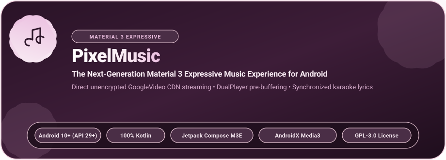

    

  <!-- Material 3 Expressive Interactive Action Badges -->
  

    
    &nbsp;&nbsp;
    
    &nbsp;&nbsp;
    
    &nbsp;&nbsp;
    
  

   

  <!-- ==================== DISTRIBUTION HUB COMPONENT ==================== -->
  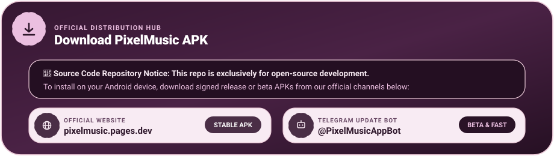

    

  <!-- ==================== SHOWCASE COMPONENT ==================== -->
  

    

  <table>
    <tr>
      <td align="center" width="33%">
        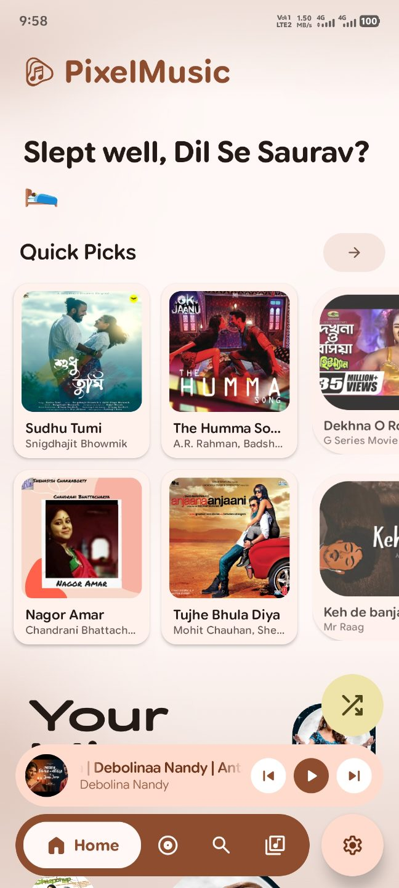 
        <b>Explore &amp; Recommendations</b> 
        InnerTube mood carousels &amp; charts
      </td>
      <td align="center" width="33%">
        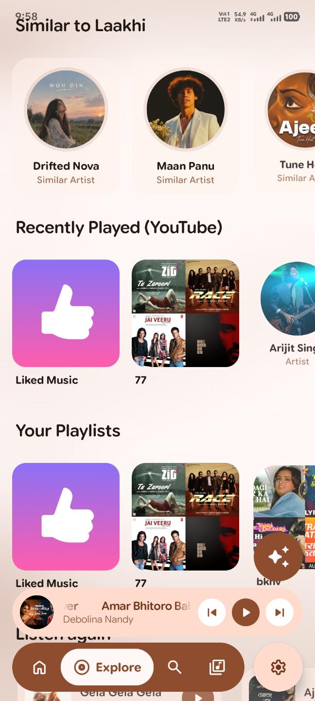 
        <b>Expressive Now Playing</b> 
        Wallpaper-reactive fluid AGSL scrim
      </td>
      <td align="center" width="33%">
        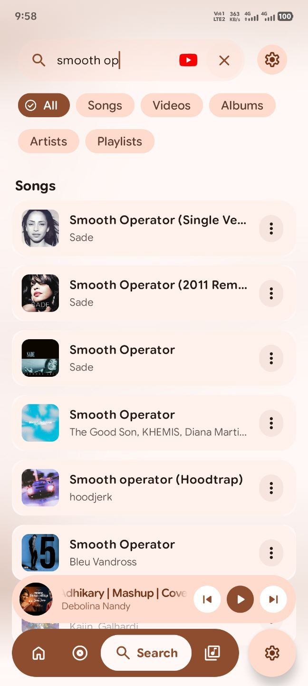 
        <b>Karaoke Synchronized Lyrics</b> 
        Live auto-scrolling with AI rescue
      </td>
    </tr>
    <tr>
      <td align="center" width="33%">
        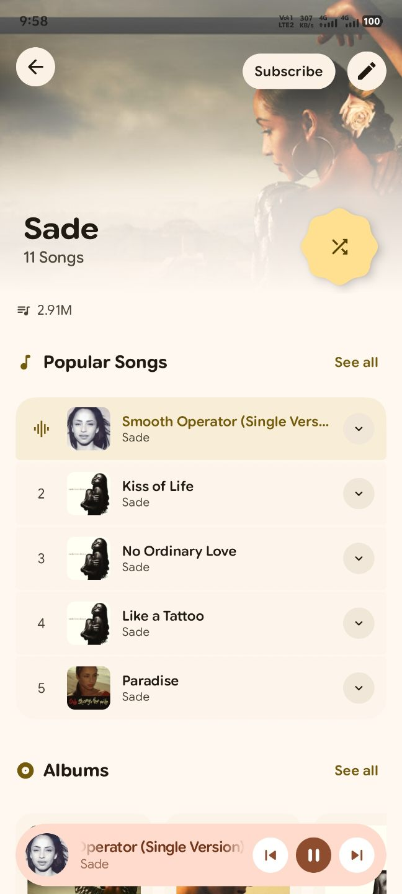 
        <b>Smart Offline Library</b> 
        Tagged downloads &amp; cloud playlists
      </td>
      <td align="center" width="33%">
        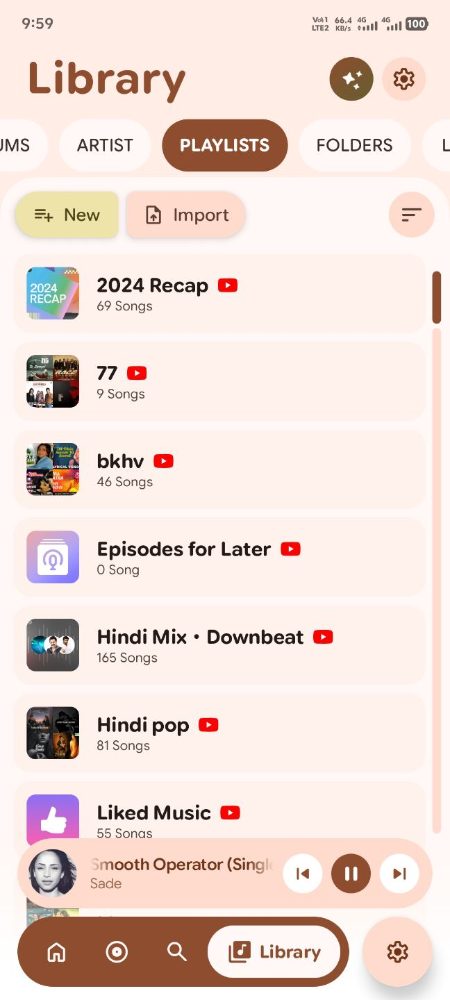 
        <b>DualPlayer Preload Queue</b> 
        Zero-gap transitions &amp; auto-queue
      </td>
      <td align="center" width="33%">
        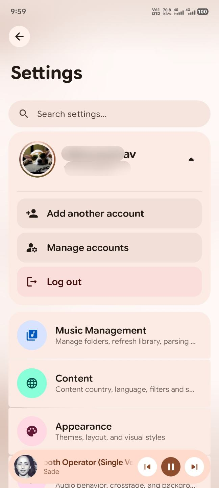 
        <b>Rich Artist &amp; Album View</b> 
        Discography, singles, and related artists
      </td>
    </tr>
    <tr>
      <td align="center" width="33%">
        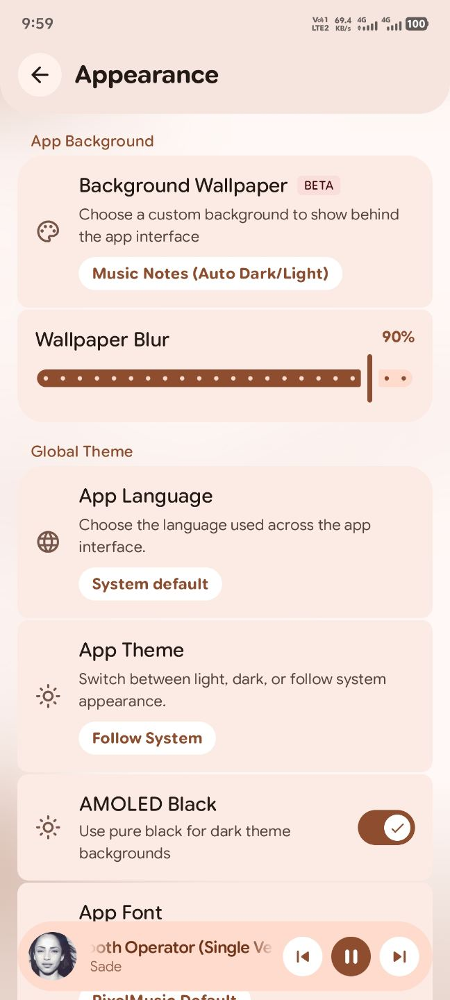 
        <b>Deep Personalization</b> 
        Dynamic palette &amp; custom accents
      </td>
      <td align="center" width="33%">
        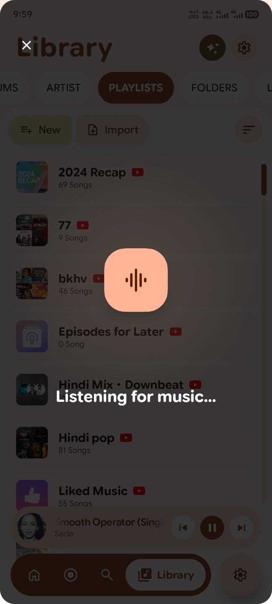 
        <b>Cloud &amp; Subsonic Servers</b> 
        Navidrome, Airsonic &amp; NetEase support
      </td>
      <td align="center" width="33%">
        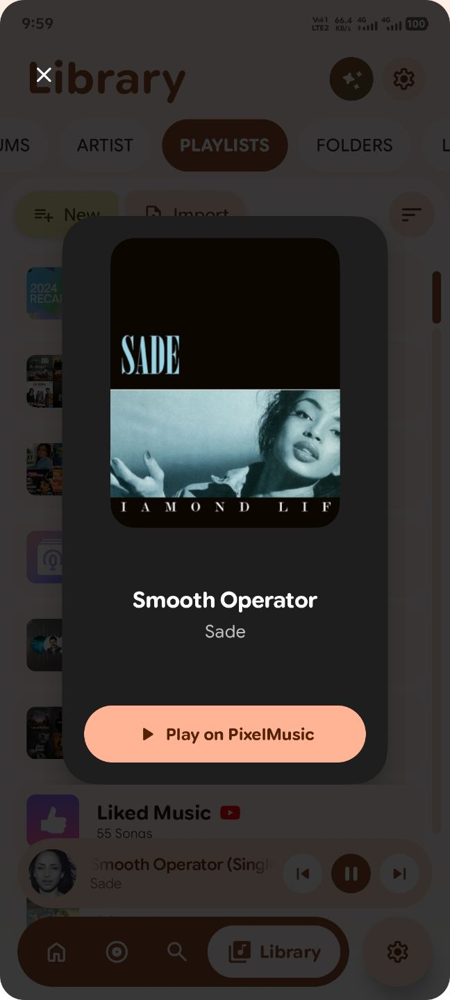 
        <b>System Capsule &amp; Widgets</b> 
        OriginOS, HyperOS, ColorOS dynamic island
      </td>
    </tr>
  </table>

   

  <!-- ==================== SIGNATURE FEATURES (BIG COMPONENTS) ==================== -->
  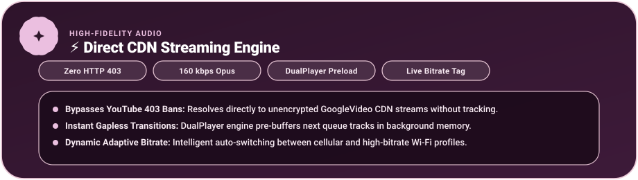

    

  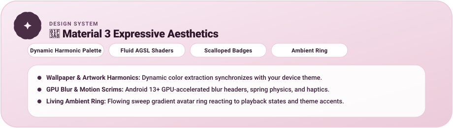

    

  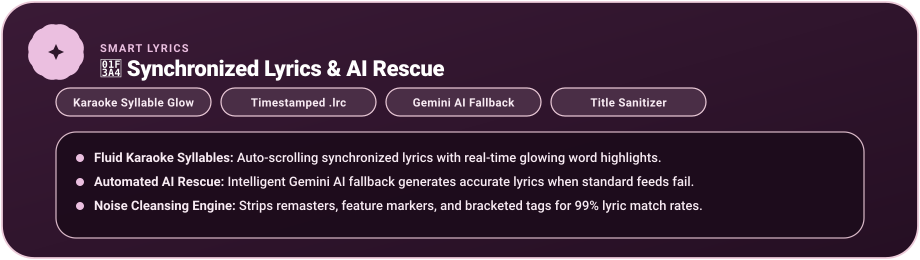

    

  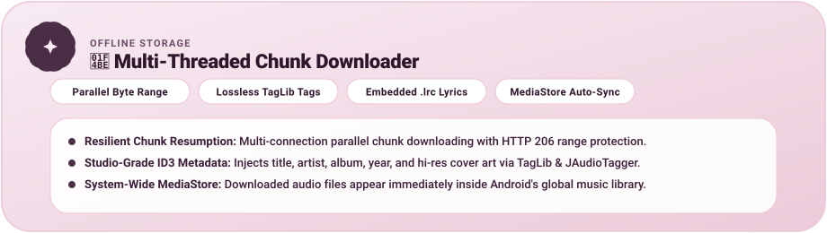

    

  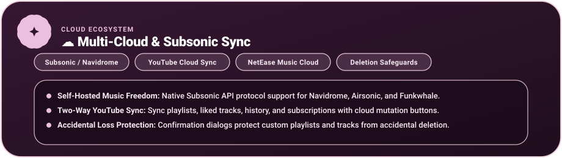

    

  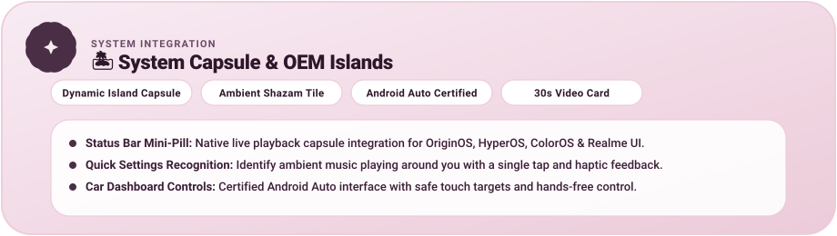

    

  <!-- ==================== AUDIO PIPELINE ARCHITECTURE ==================== -->
  

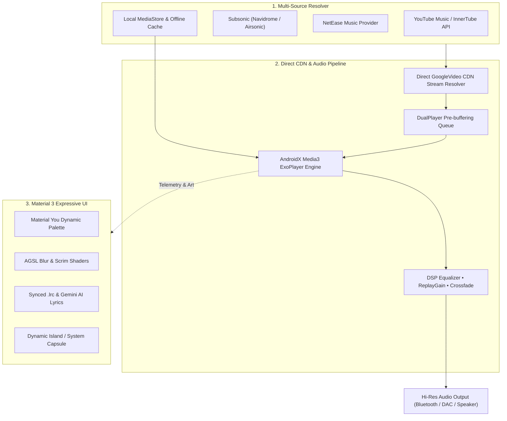

   

  <!-- ==================== TECH STACK COMPONENT ==================== -->
  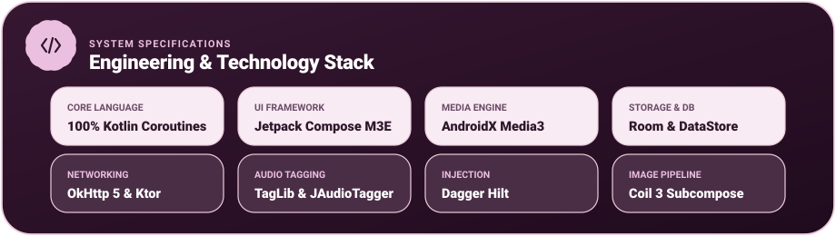

    

  <!-- ==================== COMMUNITY & CONTRIBUTORS COMPONENT ==================== -->
  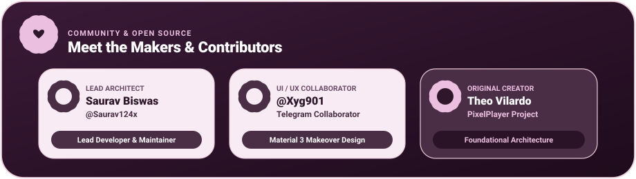

    

  <!-- Action Badges -->
  

    
    &nbsp;&nbsp;
    
    &nbsp;&nbsp;
    
  

   

  PixelMusic is an open-source project created for personal and educational music listening. All audio, album art, and artist trademarks remain the intellectual property of their respective copyright holders.

